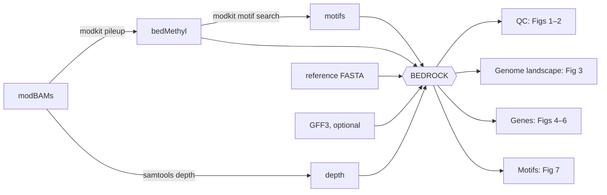

# BEDROCK

**BEDmethyl Recognition, Observation, and Characterisation Kit**

From Oxford Nanopore modBAMs to publication-ready methylation figures in one command.

BEDROCK takes [modkit](https://github.com/nanoporetech/modkit) output (or the modBAMs themselves) for any number of samples and produces coverage QC, genome-wide methylation summaries, per-window and per-gene methylation landscapes, and motif-level methylation heatmaps. It works with any organism and any modification modkit reports: 6mA, 5mC, 5hmC and 4mC.



---

## What you get

| | Figure | What it shows |
|---|---|---|
| **QC** | `figure_1a` | Mean sequencing depth per chromosome, per sample |
| | `figure_1b` | % of each chromosome covered at each depth threshold |
| | `figure2` | Base-call composition (modified / canonical / failed / …) at each depth threshold |
| **Genome-wide** | `methylation_summary` | % of A and C calls carrying each modification, per sample |
| | `figure3a` / `3b` | C+G and A+T content in 1 kb windows, both strands |
| | `figure3c` / `3d` | Modified C and modified A counts in 1 kb windows, both strands |
| **Genes** *(needs GFF3)* | `figure4a`–`h` | Gene × sample heatmaps of the 500 most variable genes (mean/median, per modification) |
| | `figure5a`–`d` | Mean methylation of every gene, per sample |
| | `figure6a`–`d` | Proportion of methylated sites per gene at 1/5/10% thresholds, plus the top 5% genes |
| **Motifs** | `figure 7` | Methylation of every modification motif, per sample and pooled per sample type |

---

## Quick start

```bash
git clone git@github.com:LSHTMPathogenSeqLab/BEDROCK.git
cd BEDROCK
conda env create -f environment.yml
conda activate methylation-analysis

python BEDROCK_main/main.py \
    --spreadsheet samples.tsv \
    --chr-list chr_list.txt \
    --ref ref.fasta \
    --annotation genes.gff3 \
    --threads 8 \
    --outdir results
```

If you dont supply an annotation file then figures 4-6 wont be produced

The environment includes modkit (≥ 0.4), samtools and minimap2. Each step prints how long it took and the peak memory used:

```
[TIME] load bedMethyl + depth: 10.3s (peak memory 0.8 GB)
[TIME] Figure 3: 31.8s (peak memory 1.6 GB)
```

---

## Inputs

### Sample spreadsheet: `--spreadsheet`

Tab-separated, **no header**, one row per sample:

| Column | Contents |
|---|---|
| 1 | **Sample name**: used on every plot |
| 2 | **Sample type**: any grouping you like (species, lineage, treatment…). Samples sharing a type are pooled in the per-type motif heatmap |
| 3 | Path to a sorted, aligned **modBAM** (`.bam` / `.cram`). The bam needs to have methylated tags inside of it from dorado basecaller |

```tsv
barcode01	L1.2.1	/data/bams/barcode01.bam	-
barcode02	L4.5	/data/bams/barcode02.bam	-
```

Plots keep the order of the spreadsheet, so reorder the rows to reorder the columns.

### Chromosome list: `--chr-list`

One chromosome per line, taken straight from a BAM:

### Reference: `--ref`

The **same** FASTA the reads were aligned to.
Make sure the `.fasta` file has been indexed 

### Annotation: `--annotation` *(optional)*

GFF3 with `gene` features carrying `ID=` (e.g. NCBI RefSeq GFF3). Without it, Figures 4–6 are skipped.

---

## Starting from modBAMs

Point column 3 at a modBAM and BEDROCK runs the modkit steps for you:

```
samtools index <bam>                                         # only if there is no index
modkit pileup <bam> <outdir>/bedmethyls/<sample>.bedmethyl --ref <ref> --threads N
samtools depth -a <bam> > <outdir>/depth/<sample>.depth       # when column 4 is -
```

Every output is **reused on later runs** if it is newer than its input, so re-running to tweak a figure takes minutes, not hours. Use `--rerun-modkit` to force a rerun. The bedMethyl and depth paths used are written to `<outdir>/samples_resolved.tsv`.

---

## Motif heatmap (Figure 7)

For each sequence motif, BEDROCK finds every occurrence in the reference and asks: **what fraction of reads are modified there?**

```
frac_mod = Σ modified calls / Σ valid calls      (over every site of the motif)
```

Motifs are discovered per sample with `modkit motif search`, and their sites located with `modkit motif bed`. Two heatmaps are drawn:

| File | Columns |
|---|---|
| `motif_heatmap_<mod>_by_sample.png` | One per sample, labelled with its sample type |
| `motif_heatmap_<mod>_by_sample_type.png` | One per sample type: samples **pooled** (Σ counts across samples), labelled with *n* |

Useful options:

```bash
--mod-code m                                   # 5mC instead of 6mA (a); h = 5hmC, 21839 = 4mC
--motif-min-cov 5                              # ignore sites with < 5 valid reads
--motif-search-args "--min-sites 100"          # find rarer / partly methylated motifs
--motifs known_motifs.csv                      # skip the search; CSV/TSV with motif,offset columns
--sample-metadata meta.csv --motif-annotate country   # colour strips from any extra columns
--skip-motifs                                  # no Figure 7
```

> **Note:** by default `modkit motif search` only reports motifs that are highly methylated (≥ 0.6) at ≥ 85% of ≥ 300 sites. Rare or partially methylated motifs need `--motif-search-args`.

**Just the heatmap** (no `.fai` or GFF needed; reuses existing modkit outputs in `--outdir`):

```bash
python BEDROCK_main/run_motif_heatmap.py \
    --spreadsheet results/samples_resolved.tsv --chr-list chr_list.txt --ref ref.fasta \
    --motifs results/motifs/*.motifs.tsv --outdir results
```

**Heatmap of any table**:

```bash
python BEDROCK_main/run_motif_heatmap.py --table some.tsv --rows label --cols sample_name --value n_sites
```

---

##  All options

<details>
<summary>Click to expand</summary>

| Option | Default | Description |
|---|---|---|
| `--spreadsheet` | *required* | Sample spreadsheet (see above) |
| `--chr-list` | *required* | Chromosome list, optionally with display names |
| `--ref` | *required* | Reference FASTA |
| `--fai` | *required* | Reference FASTA index |
| `--annotation` | none | GFF3; enables Figures 4–6 |
| `--outdir` | `results` | Output folder |
| `--coverage-thresholds` | `50 100 150 200 250 300` | Depth thresholds for Figures 1b and 2 |
| `--threads` | `4` | Threads for modkit |
| `--pileup-args` | | Extra options passed to `modkit pileup`, in quotes |
| `--motif-search-args` | | Extra options passed to `modkit motif search`, in quotes |
| `--rerun-modkit` | off | Redo pileup / depth / motif search even if outputs exist |
| `--motifs` | search | Motif tables to use instead of searching |
| `--skip-motifs` | off | Don't make Figure 7 |
| `--mod-code` | `a` | Modification for Figure 7: `a` 6mA, `m` 5mC, `h` 5hmC, `21839` 4mC |
| `--motif-min-cov` | `1` | Minimum valid reads per motif site |
| `--motif-value` | `frac_mod` | Colour by `frac_mod`, `mean_site_frac` or `n_sites` |
| `--sample-metadata` | none | Extra per-sample columns (CSV/TSV) |
| `--motif-sort-by` | spreadsheet order | Metadata column(s) to order samples by |
| `--motif-label-by` | `sample_type` | Metadata column(s) added to sample labels |
| `--motif-annotate` | none | Metadata column(s) drawn as colour strips |

</details>

---

##  Outputs

```
results/
├── figure_1a.tiff, figure_1b.tiff         coverage QC
├── figure2.tiff                           base-call composition
├── methylation_summary.tsv / .txt         genome-wide % modified, per sample
├── figure3a–d.tiff                        1 kb window landscapes
├── figure4a–h.tiff / .pdf                 gene heatmaps (top 500 variable genes)
├── figure5a–d.pdf                         gene heatmaps (all genes)
├── figure6{a–d}_{1,5,10}_percent.*        gene-level methylation + top 5% genes
├── top5_percent_genes_methylated_*.csv
├── motif_heatmap_<mod>_by_sample.png      Figure 7, per sample
├── motif_heatmap_<mod>_by_sample_type.png Figure 7, pooled per sample type
├── motif_methylation_<mod>*.tsv           Figure 7 data (long + matrix)
├── bedmethyls/  depth/  motifs/  motif_beds/   modkit / samtools outputs (reused on rerun)
├── samples_resolved.tsv                   bedMethyl + depth paths actually used
└── run_args.json                          the exact options of this run
```

---

##  Troubleshooting

| Message | Cause | Fix |
|---|---|---|
| `UNALIGNED (no @SQ lines)` | Basecaller output that was never aligned | `realign_bams.sh` |
| `not coordinate-sorted` | Unsorted BAM | `samtools sort`, or `realign_bams.sh` |
| `0 low-, 0 middle-, 0 high-frequency contexts` in a motif log | No calls for that `--mod-code` (e.g. basecalled without a 6mA model) | Check `cut -f4 sample.bedmethyl \| sort \| uniq -c` |
| `modkit not on PATH` | modkit not installed / env not active | `conda activate methylation-analysis` |
| Motif heatmap has 0 sites for every sample | Chromosome names differ between BAM and FASTA | Use the FASTA the reads were aligned to |
| Figure panel "skipped: no ['h'] calls" | That modification isn't in your data | Nothing to fix; the panel is skipped |